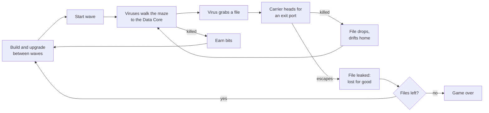

# Ctrl+Alt+Defend: product specification

Tower defense game in the browser. Viruses break into your computer to steal your data. You stop them by building
security programs on an open grid, and those programs become the walls of the maze the viruses must walk through.

How to read this document:

- **Decided**: chosen by Hugo. Change only with his agreement.
- **Call**: proposed while writing this spec and not yet confirmed by Hugo. Builders follow it; Hugo may overrule it.
- Anything not covered here is left to the builder (see "Left to the builder").

## 1. Intent

**Decided:** a tower defense game with a tech theme: you protect your data from viruses.

The core of the game:

- **Open map, you build the path.** Nothing on the map marks a route. Enemies walk the shortest open route to the
  target, and every tower you place changes that route. Placing towers well is building a maze.
- **Enemies steal, then flee.** An enemy's goal is not to reach the end of a path; it reaches your base, takes
  something, and carries it back out. Killing the carrier drops what it took, so a save at the last moment is always
  possible.
- **Readable at a glance.** Every enemy and tower type looks and behaves differently enough that you can read the
  board without opening a single tooltip.

What the tech theme adds:

- Real security vocabulary (firewall, quarantine, honeypot, zero-day) gives every piece a name players already
  half-understand, so each mechanic explains itself.
- Enemy abilities copy what real malware does (a trojan disguises itself, ransomware locks your things, a worm
  copies itself), so the theme drives the mechanics, not the reverse.

## 2. Goals, non-goals, anti-goals

### Goals

- A complete single-player campaign of three levels that can be played start to finish in a desktop browser.
- A new player understands the rules within the first wave, without reading a manual.
- Each enemy type forces a different answer, so the best build changes from level to level.

### Non-goals (Call)

- Multiplayer, accounts, online leaderboards, a backend of any kind.
- Monetization: ads, purchases, premium currency.
- A level editor or user-made maps.
- Music. Sound effects are in scope.
- Phone layouts. Desktop is the target; tablets are nice to have where they work at no extra cost.

### Anti-goals: it fails if…

- **The maze doesn't matter.** If one tower type or one placement pattern wins every level, the core idea is lost.
- **The theme is only skin-deep.** The virus abilities have to change how you play, not just how enemies look.
- **The board can't be read.** Neon effects, glitches and particles never hide where enemies, files and towers are.
- **Some players can't play it.** Keyboard play, contrast and reduced motion are requirements (see section 11), not
  polish.

## 3. Platform and constraints

- **Decided:** browser game, built on Hugo's `nextjs-template` (Next.js App Router, React, TypeScript, Tailwind).
  `AGENTS.md` rules apply in full: logic in hooks and pure modules, copy in `src/content`, token-only colors,
  accessibility checks in CI.
- **Call:** fully client-side. Progress and settings are saved in the browser (`localStorage`). No server state.
- **Call:** minimum supported viewport 1024 × 640. Below that the game shows a message asking for a larger window
  instead of a broken layout.
- **Call:** the game simulation runs at a fixed time step, independent of frame rate, so the same inputs give the
  same result on any machine. This keeps balance testable and makes the 2× speed setting exact.

## 4. Core loop

## 5. The board

### Grid and free movement

- **Decided:** towers sit on a grid; enemies do not. The grid exists only for building.
- The board is a grid of square cells drawn as a dark circuit board with glowing traces.
- **Call:** around 24 × 16 cells on the first level; exact sizes are set per level (section 9).
- Every tower occupies exactly one cell (**Call**: keeps maze building simple and precise).
- Distances in this document ("within 3 cells") are measured in cell widths, straight line, from the center of the
  enemy or tower.

### Data Core

- The base you defend, placed near the middle of the board, occupying a 2 × 2 block of cells.
- It holds the level's **data files** (8 on the first level). Files are your lives. The Core shows how many files it
  still holds, and each file is visible as a small icon on or around it.

### Ports

- Viruses enter through **ports** on the edges of the board. Each port is a gap in the board's border.
- Every port is both an entrance and an exit.
- The Core cells, port cells and the cell directly inside each port can never be built on.

### Pathing rules

- **Decided:** enemies walk freely, not cell to cell. They move in any direction, take the direct line across open
  space, and curve smoothly around towers instead of turning in right angles or 45° steps.
- **Call:** enemies are smaller than a cell, so a one-cell gap between towers is always passable. Two towers that
  touch at a corner form a closed wall; enemies can't slip between them.
- **Call:** each enemy keeps a small personal offset from the ideal route, so a group spreads across the open
  space instead of marching in single file. Enemies may overlap each other; they never push one another.
- Enemies never pass through towers, the board border or the Core.
- Viruses without a file walk the shortest open route from where they are to the Core.
- A carrier walks the shortest open route to the nearest exit port (nearest by path length, not straight-line
  distance).
- When the maze changes, every enemy on the board recalculates its route from its current position.
- **Placement is refused** when the new tower would:
  - leave any port with no route to the Core, or
  - overlap an enemy or a dropped file currently on the board.
- While placing, the game shows the route viruses would take if the tower were built there, so you see the maze
  change before you commit.

## 6. Files: stealing, dropping, leaking

- A virus that reaches the Core takes **one** file and becomes a **carrier**. A carrier never takes a second file.
- When a carrier dies, its file **drops** at the spot where it died. A dropped file drifts slowly back to the Core
  along the open route and rejoins the Core when it arrives.
- Any virus without a file that touches a dropped file picks it up and becomes a carrier on the spot.
- While the Core holds no files, viruses without a file walk toward the nearest dropped file. If no file is dropped
  either, they walk to the Core, find nothing, and leave through the nearest exit port. Leaving with nothing costs you
  nothing.
- When a carrier walks out of a port, its file is **leaked** and is gone for the rest of the level.
- **The level is lost when every file has leaked.** Files that are carried or dropped are not lost yet.
- **The level is won when the last wave is cleared** with at least one file not leaked.

Carriers are the most urgent target in the game. They glow, show the file they hold, and towers target them first
(section 8).

## 7. Economy

- The currency is **bits**. You start each level with a fixed amount and earn more for every virus destroyed.
- Bits are spent on building, upgrading and unlocking (ransomware). They do not carry over between levels.
- **Selling** a tower refunds part of everything spent on it (**Call:** 70%). Selling during a wave is allowed.
- **Call:** calling the next wave early grants a small bonus of bits, scaled by how much build time was skipped.
- No interest, no passive income. Apart from the early-wave bonus, kills are the only income during a level.

## 8. Towers

### Shared rules

- Towers are built from the build menu onto an empty cell. Building is allowed during waves and between them.
- Attacking towers have a **range** (shown as a circle while placing or selecting) and fire at one enemy at a time
  unless their entry says otherwise.
- **Targeting (Call):** a tower targets, among the enemies it can see in range: carriers first, then whichever enemy
  is closest to the Core by remaining path length. No per-tower targeting modes.
- **Hidden enemies (Call):** an unexposed Trojan or an unseen Spyware can't be picked as a target, by a tower or by
  Patch. Effects that hit an area without picking a target (Quarantine's slow and damage, Honeypot's lure) affect
  every enemy inside the area, hidden or not.
- **Versions:** towers that can be upgraded go v1.0 → v2.0 → v3.0. Each version raises the tower's numbers; v3.0
  also adds the extra listed in the table. The version is drawn on the tower.
- A tower can be sold or upgraded from its info panel, which also shows its stats and what the next version adds.

### Tower list

| Tower      | Role                          | What it does (v1.0)                                                                                                                                                                                               | v3.0 extra (Call)                                             | Cost tier |
| ---------- | ----------------------------- | ----------------------------------------------------------------------------------------------------------------------------------------------------------------------------------------------------------------- | ------------------------------------------------------------- | --------- |
| Firewall   | Maze wall                     | Blocks a cell. Does not attack. Cannot be upgraded.                                                                                                                                                               | none                                                          | Very low  |
| Antivirus  | Basic damage                  | Fires single projectiles at a steady rate. Medium range.                                                                                                                                                          | Projectiles pierce through to a second enemy behind the first | Low       |
| Scanner    | Detection                     | Deals no damage. Makes Spyware in its range visible to every tower and exposes Trojans in its range early (section 10).                                                                                           | Enemies in its range take extra damage from all sources       | Medium    |
| Quarantine | Crowd control and area damage | Slows every enemy in its range. From v2.0 (Call) it also deals light damage over time to every enemy in its range: the main answer to swarms.                                                                     | Enemies that enter its range are briefly frozen in place once | Medium    |
| Debugger   | Single-target, anti-armor     | Holds a continuous beam on one enemy; damage grows the longer the beam stays on the same target and resets when it switches. Strongest answer to armor and bosses.                                                | Beam chains to one nearby enemy at reduced damage             | High      |
| Honeypot   | Lure                          | Pulls viruses without a file that pass within its range off their route; they walk to it and stay stuck for a few seconds, then resume. Has a limited number of charges, then must cool down. Carriers ignore it. | More charges and a longer hold                                | Medium    |
| Patch      | Global ability                | Does not attack on its own. Once charged, you pick a virus type and it deals heavy damage to every virus of that type on the board. Long recharge. Limit one per level.                                           | Shorter recharge                                              | Very high |

Design intent for the set:

- **Firewall** exists so maze building is cheap; damage towers should not be the only walls.
- **Scanner** is the hard counter to Spyware and the soft counter to Trojans. A board with no Scanner must be
  survivable but painful on levels where they appear.
- **Debugger** rewards long, winding paths where one target stays in its beam.
- **Honeypot** is a maze tool too: it buys time without changing the walls.

## 9. Levels and waves

### Campaign

| Level               | Ports | Files | Waves | New threats introduced                     |
| ------------------- | ----- | ----- | ----- | ------------------------------------------ |
| 1. Home PC          | 2     | 8     | 20    | Bug, Worm, Spyware, Botnet, first Zero-Day |
| 2. Company Server   | 3     | 10    | 25    | Trojan, Rootkit                            |
| 3. Cloud Datacenter | 4     | 12    | 30    | Ransomware                                 |

- **Decided:** the three settings and the rule that each later level has more ports and more files.
- **Call:** the port, file and wave counts above, and which threats each level introduces.
- Levels unlock in order. Finishing a level unlocks the next one. Any unlocked level can be replayed.
- **Call:** each level ends with a result screen showing files kept and a 1 to 3 star rating: 3 stars for no files
  leaked, 2 for at least half kept, 1 for winning at all. The best result per level is saved.

### Waves

- **Call:** play is split into numbered waves with a build break between them, rather than one continuous stream.
  The break has a countdown; the player can start the next wave early.
- Each wave has a fixed, authored composition (which virus types, how many, from which ports, with what spacing).
  Enemy health grows from wave to wave.
- A **Zero-Day** boss arrives on every 10th wave.
- The HUD previews the next wave's composition so players can prepare (for example, build a Scanner before Spyware).

### Speed

- Pause, 1× and 2× speed. Building and inspecting are allowed while paused.

## 10. Enemies

All enemies are viruses. Each has health, speed, a bits reward, and at most one special rule. Numbers are left to
the builder; the relative values below are the design.

| Virus           | Health      | Speed  | Special rule                                                                                                                                                                                                  |
| --------------- | ----------- | ------ | ------------------------------------------------------------------------------------------------------------------------------------------------------------------------------------------------------------- |
| Bug (Call)      | Low         | Normal | None. The basic enemy for early waves.                                                                                                                                                                        |
| Worm            | Low         | Fast   | Splits into two smaller worms on death. The small ones have less health and do not split again. A carrier worm drops its file like any carrier; the halves can pick it back up.                               |
| Trojan          | Medium-high | Normal | Disguised as a harmless data packet: towers ignore it until it comes within 3 cells of the Core, or until a Scanner sees it. Once exposed it stays exposed and speeds up briefly.                             |
| Spyware         | Medium      | Normal | Invisible. Towers can only target it while it is inside a Scanner's range. Drawn as a faint shimmer so the player knows it exists.                                                                            |
| Rootkit         | Very high   | Slow   | Armor: every hit's damage is reduced by a flat amount, so many weak hits do little and a few strong ones (or the Debugger's ramped beam) do well.                                                             |
| Ransomware      | Medium      | Normal | Every few seconds it locks the nearest tower within 2 cells. A locked tower stops working for a set time; the player can pay bits to unlock it at once. Killing the Ransomware unlocks every tower it locked. |
| Botnet          | Very low    | Fast   | Arrives as a swarm of 20 to 30 at once. Single-target towers can't keep up; it tests Quarantine's area damage, slows and Antivirus pierce.                                                                    |
| Zero-Day (boss) | Huge        | Slow   | When it spawns, it becomes immune to every effect of the tower type you have the most of (ties go to the type with the most bits invested; Firewalls don't count). Its immunity is shown on it.               |

Notes:

- A carrier keeps its own special rule (an invisible Spyware carrier stays invisible; its carried file does not).
  **Call:** a carried file is always visible, even on invisible carriers, so the player always knows where their
  data is.
- Zero-Day's rule punishes spamming one tower type, which supports the anti-goal "one tower wins everything".

## 11. Controls, interface and accessibility

### Screens

1. **Title**: play, how to play, settings.
2. **Level select**: the three levels, locked or unlocked, best star rating each.
3. **Game**: board plus HUD.
4. **Pause** overlay: resume, restart level, settings, quit to level select.
5. **Result**: won or lost, files kept, stars, next level / retry / level select.
6. **How to play**: one short screen with the rules from sections 5 to 8. The first level also shows brief
   in-game hints the first time each new thing appears (first carrier, first Spyware…).

### HUD

- Files left (with leaked ones shown crossed out), bits, current wave / total, next-wave preview and countdown,
  start-wave-now button, speed and pause controls, sound toggle.
- The build menu lists every tower with its cost; unaffordable towers are visibly disabled with the reason stated.
- Selecting a tower opens its info panel: version, stats, upgrade (with cost and what changes), sell (with refund).

### Mouse

- Pick a tower in the build menu, hover the board to see a placement preview (tower ghost, range circle, new
  route), click to place. Right-click or Escape cancels.
- Click a placed tower to open its info panel.

### Keyboard (required)

The whole game can be played with the keyboard alone.

- A visible board cursor moves cell by cell with the arrow keys.
- Number keys pick a tower from the build menu; Enter places it at the cursor; Escape cancels.
- With the cursor on a tower: a key to upgrade, a key to sell (exact bindings are the builder's choice and are
  listed on the How to play screen).
- Space pauses and resumes; a key starts the next wave; a key toggles speed.
- Every HUD control is a real, focusable button with an accessible name.

### Accessibility requirements

- Placement validity and every other state are never shown by color alone: an invalid placement also shows a
  blocked icon, a locked tower a padlock, a carrier the file icon.
- Important events are announced to screen readers through a live region: wave start, file stolen, file leaked,
  tower locked, level won or lost.
- `prefers-reduced-motion`: no screen shake, no glitch distortion, no particle bursts; hits and deaths use short
  opacity fades instead. Gameplay is identical.
- All text and UI colors meet WCAG 2.2 AA contrast, as the template's token tests require.

## 12. Look and sound

- **Decided:** neon on a dark background, circuit-board grid, enemies that glitch when hit, terminal-style menus.
- **Call:** monospace type for HUD numbers and menus; towers and enemies drawn as simple, bold geometric icons
  that stay recognizable at small sizes.
- **Call:** the game is designed for a dark look only. How the template's light and dark token schemes map to that
  is left to the builder, as long as the contrast tests stay green.
- Each virus type has its own color and silhouette. Each tower's range circle uses its tower's color.
- **Sound effects (Call):** short synth blips for firing, hits, deaths, file stolen, file leaked, wave start, level
  won and lost. Mutable, with the setting saved. No music.

## 13. Saved data

Saved in the browser, per device:

- Unlocked levels and the best result for each.
- Settings: sound on/off, default speed.

**Call:** a level in progress is not saved; leaving it means restarting it.

## 14. Left to the builder

- All numbers: grid sizes per level, health, speed, damage, ranges, costs, rewards, timers, wave compositions,
  starting bits. Section 8 and 10 tables give the relative values to respect.
- Rendering approach for the board (for example Canvas 2D, SVG or DOM), as long as the board stays readable,
  meets section 11 and keeps the HUD and menus as accessible HTML.
- Exact keyboard bindings.
- Exact art and sound assets within section 12.
- Code structure, inside the rules of `AGENTS.md`.

## 15. Glossary

| Term      | Meaning                                                            |
| --------- | ------------------------------------------------------------------ |
| Data Core | Your base; holds the files                                         |
| File      | One life; can be stolen, dropped and leaked                        |
| Carrier   | A virus holding a file                                             |
| Leaked    | A file carried out through a port; permanently lost for the level  |
| Port      | Entrance and exit on the board's edge                              |
| Bits      | Currency                                                           |
| Version   | Tower upgrade level (v1.0, v2.0, v3.0)                             |
| Wave      | One authored group of enemies; waves are separated by build breaks |
